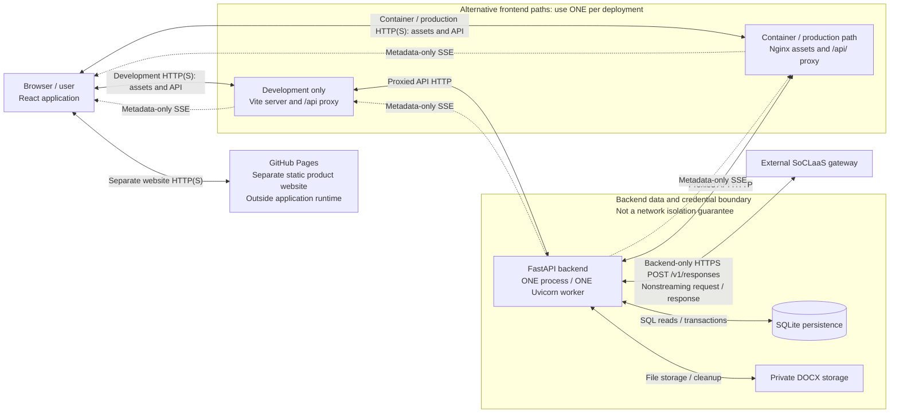
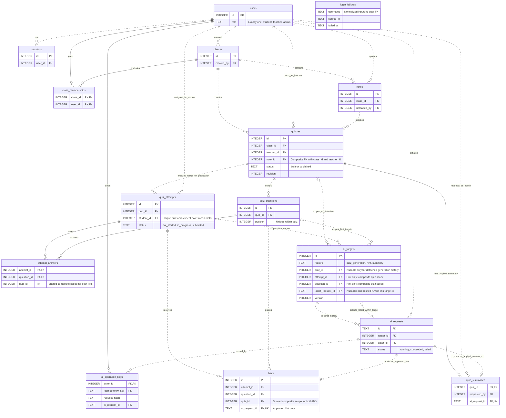
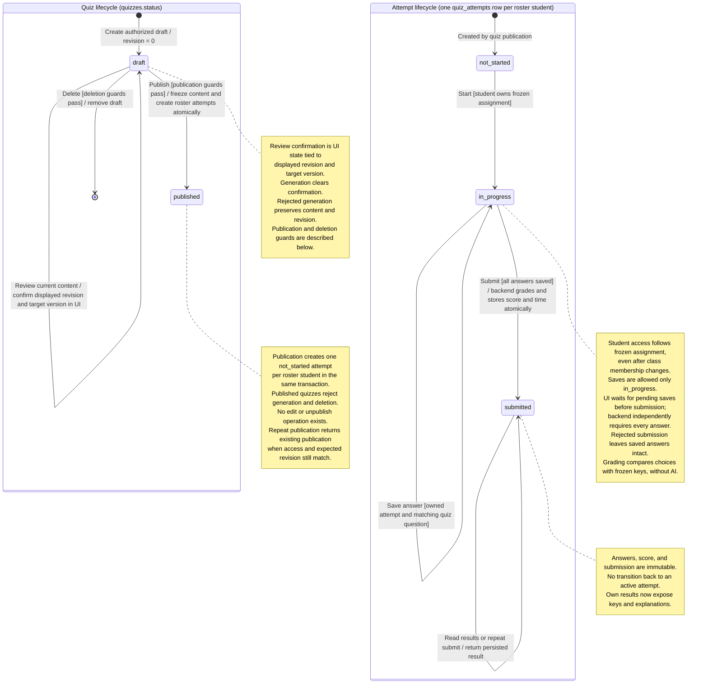

# QuizIt developer guide

## 1. Project overview and repository map

QuizIt is a secured class quiz application. Teachers generate quizzes
from DOCX notes and review them before publication; students complete assigned quizzes
with optional AI hints; administrators manage accounts/classes and request AI performance
summaries after the publication roster has fully submitted.

The [User Guide](UserGuide.md) explains user actions.
Product contracts and acceptance criteria remain in the
[backend specification](../specs/backend-spec.md),
[frontend specification](../specs/frontend-spec.md), and
[reference schema](../specs/schema.sql). The
[assignment brief](../assignment-brief.md) defines engineering/submission constraints.

| Location                            | Purpose                                                                                            |
| ----------------------------------- | -------------------------------------------------------------------------------------------------- |
| `frontend/`                         | React 19, TypeScript, Tailwind CSS, Vite, and frontend tests                                       |
| `backend/`                          | Python 3.14, FastAPI, SQLite, SoCLaaS, and backend tests                                           |
| `specs/`, `docs/`                   | Contracts/acceptance criteria/DDL; guides and reflections                                          |
| `workflow/`, `logs/`                | Implementation mappings, reviews, validation, security/evaluations; verified interaction summaries |
| `.agents/skills/`, `.codex/agents/` | Project guidance and named review profiles                                                         |
| `pages/`, `.github/workflows/`      | Separate static product website; checks/security scanning/Pages deployment                         |

Frontend/backend have separate dependencies and lockfiles. Run component commands
from their own folders; run Compose and evaluation commands from the repository root.

## 2. System architecture and deployment boundaries

The React single-page application uses relative `/api/v1`
requests with session cookies. Vite proxies `/api` during native development. In Docker,
Nginx serves compiled assets and forwards `/api/` without stripping the path. The browser
uses one frontend/API origin even when the backend is a separate hosted service.

FastAPI runs in one process with one Uvicorn worker. Domain services use SQLite and
private DOCX storage. Only the backend contacts SoCLaaS. A lifespan-owned HTTPX client
is shared across AI tasks; accepted work runs in strongly referenced asyncio tasks
independently of browser connections. Persisted AI rows record history/recovery state;
they do not schedule or resume work after restart.



Sources: [lifespan](../backend/src/quiz_backend/main.py),
[CLI](../backend/src/quiz_backend/cli.py), [Compose](../compose.yaml),
[Vite](../frontend/vite.config.ts), and [Nginx](../frontend/nginx.conf).
The [Pages workflow](../.github/workflows/pages.yml) publishes only `pages/` from
`master`, not the application or private data.

Production needs HTTPS, persistent backend
disk, one instance/worker, and deliberate proxy trust. Application CI checks do not deploy.
The Render auto-deployment observation in section 10 does not establish dashboard settings.

## 3. Local development and configuration

### Native development

Use Node.js 24 (matching frontend CI/Docker), npm, Python 3.14, and uv. See the
[frontend README](../frontend/README.md) and [backend README](../backend/README.md).
Preserve existing private `.env` files. On a fresh checkout, create `backend/.env` from
[its example](../backend/.env.example), configuring local paths/origins and AI privately.
From `backend/`:

```sh
uv sync --locked
uv run --locked quiz-backend serve --host 127.0.0.1 --port 7000
```

Startup initializes/seeds demo users and two classes only when no users exist, in both
environments; existing data survives restart. Demo credentials are in the backend README.
API docs/OpenAPI are `/api/v1/docs` and `/api/v1/openapi.json`.

Keep the backend running in its terminal. Open a second terminal and, from
`frontend/`, run `npm ci`. Create/update `frontend/.env` with:

```dotenv
BACKEND_SERVER_URL=http://localhost:7000
```

Then run `npm run dev` and open `http://localhost:5173`.
The current [frontend example](../frontend/.env.example) contains
backend-style environment/origin values and omits this required URL. Copying it alone
is insufficient: Vite refuses development startup without `BACKEND_SERVER_URL`.

Use an HTTP(S) backend origin without an API path. Vite keeps this unprefixed value
server-side; `changeOrigin: true` sets upstream Host while preserving browser Origin.
HTTPS verification remains enabled. Restart Vite after changes. For trusted network
CAs, follow README Node system/custom CA instructions rather than disabling verification.
`npm run build` creates `frontend/dist`; `npm run preview` does not proxy the API.

### Setup success checks

With both servers running:

1. Open `http://127.0.0.1:7000/api/v1/openapi.json`; a successful JSON response
   confirms API availability. Interactive docs are at `http://127.0.0.1:7000/api/v1/docs`.
2. In a fresh browser session without a login cookie, open
   `http://localhost:5173/api/v1/auth/me`. Expect HTTP 401 with a structured
   `AUTH_REQUIRED` error. This confirms the frontend proxy reaches the backend;
   HTTP 502 instead indicates an upstream connection problem.
3. Open the frontend login page and use a demo account from the backend README.
   After login, `/api/v1/auth/me` on the frontend origin should return HTTP 200
   with the authenticated identity and the appropriate role workspace should open.

### Backend settings and precedence

[Settings](../backend/src/quiz_backend/config.py) reads `.env`
from the working directory. Environment variables override dotenv values, then code
defaults apply. Relative database/storage paths resolve from the process working directory.

| Setting                                                                                        | Current behavior                                                                           |
| ---------------------------------------------------------------------------------------------- | ------------------------------------------------------------------------------------------ |
| `ENVIRONMENT`                                                                                  | Default development; production enables Secure cookies and requires HTTPS explicit origins |
| `DATABASE_PATH`, `STORAGE_PATH`                                                                | Defaults `private/development.sqlite3`, `private/notes`                                    |
| `ALLOWED_ORIGINS`                                                                              | Code default `["http://localhost:5173"]`; backend example `["*"]`                          |
| `SOCLAAS_BASE_URL`, `SOCLAAS_API_KEY`                                                          | HTTPS gateway origin and private credential; backend appends `/v1/responses`               |
| `SOCLAAS_HINT_MODEL`, `SOCLAAS_QUIZ_MODEL`, `SOCLAAS_SUMMARY_MODEL`                            | Fixed model per feature; any/all may share an ID                                           |
| `SOCLAAS_HINT_CONTEXT_TOKENS`, `SOCLAAS_QUIZ_CONTEXT_TOKENS`, `SOCLAAS_SUMMARY_CONTEXT_TOKENS` | Positive verified context budgets, configured separately                                   |

No runtime model lookup occurs; the [supplied catalog](../backend/soclaas-docs.md) is
a dated snapshot, not an availability guarantee. Invalid AI configuration returns
`AI_CONFIGURATION_ERROR` before fresh admission; ordinary workflows remain available.

Defaults include 16,000 extracted note characters, 1,000 successful hints per
attempt/question, 256 KiB response bodies, and output budgets of 8,192 hint, 32,768 quiz,
and 8,192 summary tokens. See settings for configurable login/shutdown/heartbeat limits.
Fixed task admission/deadline rules are in section 7.

### Docker Compose

Use Docker Engine or Docker Desktop with a recent Compose plugin supporting
`--wait` and optional `env_file` entries (`required: false`). Run from the repository root:

```sh
docker compose up --build -d --wait
docker compose logs --tail=100
docker compose down
```

Open `http://localhost:8080` or `/api/v1/docs` on that origin. Only the loopback frontend
port is published; Compose waits for backend health. Project-scoped `backend-data`
preserves SQLite/notes through replacement and `down`; `down --volumes` deletes it.

Compose optionally reads `backend/.env`, but overrides backend
`DATABASE_PATH` and `STORAGE_PATH` with `/app/private/quiz.sqlite3` and `/app/private/notes`.
`APP_ENVIRONMENT` and `APP_ALLOWED_ORIGINS` are Compose interpolation inputs: their
values become backend `ENVIRONMENT` (default `development`) and `ALLOWED_ORIGINS`
(default `["*"]`), overriding those settings from the backend environment file.
`BACKEND_ENV_FILE` selects a different backend environment file.

Nginx defaults to `BACKEND_SERVER_URL=http://backend:7000`. To load a frontend environment
file, use `docker compose --env-file frontend/.env up --build -d --wait`. The origin
must be reachable inside Docker; container localhost is not the host/backend. After a
URL change:

```sh
docker compose --env-file frontend/.env up -d --no-deps --force-recreate frontend
```

Recreation reloads environment values without rebuilding; plain restart does not.
Do not share secret-bearing resolved Compose output. Standalone image commands are
in component READMEs.

## 4. Domain model and persistence

Explicit SQL through `aiosqlite` implements persistence, not ORM
entities. [Reference DDL](../specs/schema.sql) and
[initial migration](../backend/src/quiz_backend/migrations/001_initial.sql) define
aligned tables/constraints; [Database](../backend/src/quiz_backend/db.py) also creates
`schema_migrations` bookkeeping.



Composite foreign keys keep notes, quizzes, attempts, questions, answers, and hints
in matching class/teacher or quiz scope. Partial unique indexes allow one generation
and one summary target per quiz, and one hint target per attempt/question. A target
may initially have no latest request; when present, its composite reference selects
a request belonging to that same target. These composite, feature-specific, and
conditional constraints are not all expressible in Mermaid cardinalities.

| Entity                                | Relationships and responsibility                                                 |
| ------------------------------------- | -------------------------------------------------------------------------------- |
| `users`, `sessions`, `login_failures` | One role/user; many hashed-token sessions/user; persistent username/IP failures  |
| `classes`, `class_memberships`        | Admin-created classes; many-to-many student/teacher membership                   |
| `notes`                               | One uploader/class; extracted text and private-file metadata                     |
| `quizzes`                             | One teacher/class/note; a note may support multiple quizzes; status/revision     |
| `quiz_questions`                      | Ordered quiz questions; options A–D are columns, with key/explanation            |
| `quiz_attempts`                       | Unique quiz/student; created at publication, representing the frozen roster      |
| `attempt_answers`                     | One choice per attempt/question; composite foreign keys prevent cross-quiz scope |
| `ai_targets`                          | Generation/summary per quiz or hint per attempt/question; latest pointer/version |
| `ai_requests`                         | Many/target; private input, actor/model, lifecycle/deadline, usage, result/error |
| `ai_operation_keys`                   | Actor/key uniqueness binds canonical requests; many keys may reuse one task      |
| `hints`                               | Approved history linked to attempt/question and AI request                       |
| `quiz_summaries`                      | At most one applied successful summary/quiz, metric snapshot, AI request         |

### Invariants and transactions

Quizzes have 1–10 questions, four distinct options, one correct option, and an explanation.
Publication freezes valid content and a nonempty roster atomically by creating attempts.
Later membership changes do not alter attempts or completion denominators. Submission
requires every answer and deterministically grades without AI; submitted attempts are immutable.

Every connection enables foreign keys and a five-second busy timeout; initialization
enables WAL. Reads use explicit snapshot transactions; writes use `BEGIN IMMEDIATE`.
Publication, generation admission/completion, answer saving, and submission serialize state
checks. No transaction spans gateway I/O. Conditional writes check affected rows. Roles,
immutable snapshots, matching target/results, and some state rules are application-enforced
in addition to SQL constraints.

Draft deletion rejects published/running-generation quizzes, cascades questions, and removes
a note only after its last quiz reference disappears. Private files are removed after commit;
startup retries orphan cleanup for generated filenames. Terminal generation targets detach
from deleted quizzes, retaining tasks/keys/rate accounting; historical resource reads return 404. Quiz/note IDs use `AUTOINCREMENT`. SQLite and files are not one transaction; shielded
persistence and cleanup implement recovery around these boundaries.

### Initialization and schema changes

Only version 1 exists. Initialization applies its SQL only when version 1 is absent;
it does not compare/upgrade existing tables. WAL setup is outside that transaction.
Both reference and migration include failed-login accounting.

Older version-1 databases missing later initial-schema changes are **not automatically
upgraded**. Fresh disposable databases use current DDL; preserving older data requires
an explicit migration plan. Do not delete production data to resolve drift. Future schema
changes must add migration handling and align reference DDL, specifications, implementation,
and acceptance tests.

## 5. Frontend architecture

[Frontend source](../frontend/src) separates role screens from
authentication, typed API access, and shared state infrastructure.

| Module                          | Responsibility                                                                                |
| ------------------------------- | --------------------------------------------------------------------------------------------- |
| `App.tsx`, `auth/`              | Identity restoration, login/logout, expiry, role workspace selection                          |
| `api/client.ts`, `api/types.ts` | Cookie requests, typed contracts, safe errors, 15-second request timeout, session-loss events |
| `admin/`                        | Overview, accounts, classes/memberships, completion/summaries                                 |
| `teacher/`                      | Class/quiz lists, DOCX upload, draft creation, generation/review/publication/deletion         |
| `student/`                      | Assigned quizzes, attempts, answer saves, hints, submitted results                            |
| `shared/`                       | UI, guarded resource reads, session-owned SSE, AI reconciliation                              |

Role applications use hash navigation rather than a routing-library dependency.
`AuthProvider` reads backend identity and checks sessions periodically and on focus/online.
Session loss unmounts the workspace. Sessions use HttpOnly cookies; prompts, selections,
and tasks are not stored in browser persistence. Saved state/history lives in the backend.

### Shared AI reconciliation

[TargetStore](../frontend/src/shared/TargetStore.ts) tracks applied and highest-notified
versions separately, coalesces reads, and discards older responses. An admission barrier
suppresses earlier reads while a generation POST is unresolved. Rejected admission
preserves prior state; uncertain network/server outcomes retain original input/UUID key
for explicit repeat. Distinct new work uses fresh keys.

[useAIEvents](../frontend/src/shared/useAIEvents.ts) opens SSE before target entry reads,
refreshes on stream establishment/reconnection, focus, and network recovery, and disposes
stores/requests on cleanup. Unfinished tasks reconcile every five seconds despite healthy
SSE; read failures back off up to 30 seconds without generating work. Reads below notified
versions leave targets unresolved.

`SummaryStore`/`GenerationStore` use quiz IDs; `HintStore` uses `attempt:question` keys.
Latest running/failed hint or summary state hides older success. Generation reads task
state followed by current quiz content; historical task success snapshots cannot become
the reviewed draft, and revisions/published status cannot regress.

### Role-specific state

Teacher multipart uploads let the browser set the boundary. Browser file checks aid
usability; backend validation is authoritative. Review confirmation binds to displayed
revision and target version and resets on changed generation state. Deletion retires
cached targets and ignores late responses.

Student lists use frozen assignments, not current membership. Answer saves are serialized
per question; different questions may save independently. Submission locks controls,
waits for pending saves, and stops on failure. Conflicts/uncertain submission outcomes
require an authoritative attempt read; failed reconciliation retains the lock. Results
mount only after confirmed submission. Hints do not gate answer saving/submission.
Generated text uses React escaping, without raw HTML rendering.

## 6. Backend architecture and role workflows

[Backend source](../backend/src/quiz_backend) separates ordinary
routes from AI admission/state routes. Full endpoints/error contracts remain in the backend
specification.

| Module                            | Responsibility                                                                   |
| --------------------------------- | -------------------------------------------------------------------------------- |
| `main.py`, `config.py`, `cli.py`  | Lifespan, middleware/errors, settings, shared client, one-worker launch          |
| `db.py`, `seed.py`, `migrations/` | SQL transactions, initialization, fresh-database fixtures                        |
| `auth.py`, `schemas.py`, `api.py` | Identity/roles, strict role contracts, ordinary routes                           |
| `core.py`                         | Accounts/classes, ownership, notes/drafts, publication, attempts/grading/metrics |
| `notes.py`, `ai.py`               | Safe DOCX handling and bounded stateless SoCLaaS operations                      |
| `tasks.py`                        | Admission/idempotency, task supervision, deadlines, atomic completion            |
| `tasks_api.py`, `events.py`       | Latest/history reads and scoped metadata-only SSE                                |
| `errors.py`, `time.py`            | Safe errors and clock helpers                                                    |

Startup initializes/seeds, creates private storage, interrupts leftover running tasks,
and cleans orphan note files before serving. Shutdown stops admission, settles admissions,
gives active work bounded grace, cancels remaining work, and persists interruption where
possible. Startup handles leftovers after hard crashes without replay. Blocking DOCX
parsing/storage and password hashing execute outside the event loop.



### Admin

Admins create students/teachers, not additional admins; create classes; assign/unassign
members; and inspect published quiz completion. Assignment is idempotent. Summary admission
requires full frozen-roster submission. Backend metrics remain authoritative. Admin
components implement actions; backend services independently enforce eligibility.

### Teacher

A teacher must own a quiz and remain assigned to its class. Validated DOCX upload precedes
private storage/draft creation. Generation/reprompting is described in section 7.
Publication requires UI confirmation of the displayed revision and target version, with
resolved state and no competing operation. The backend atomically checks the owning
teacher is still assigned, `expected_revision` matches, questions are valid and complete,
no generation is running, and the student roster is nonempty. Frontend review is a human
gate, but the backend cannot prove attentive reading. Published quizzes reject generation
and deletion; no edit or unpublish operation exists.

Draft deletion requires explicit UI confirmation and resolved idle state. The backend
independently requires an owning, still-assigned teacher, draft status, and no running
generation. Notes are removed only after their last quiz reference disappears.

### Student

Frozen-roster access survives class unassignment. Starting resumes the single precreated
attempt; saves upsert one option per question. Submission requires all answers, awards
one point per correct answer, and stores score/time atomically. Repeated submission
returns persisted results. Separate results reads release keys/explanations only after
that student's submission. Another student's resource IDs grant no access.

## 7. AI features and shared task lifecycle

Exactly three application AI operations exist: `generate_quiz`,
`generate_hint`, and `generate_quiz_result_summary`. Hint verification is an internal
second call, not a fourth feature. Each feature has a fixed model and independent limits;
model IDs may be shared.

Timeout, cancellation, process restart, or failed pre-execution checks may occur
before any provider response, including before a provider call. The sequence groups
these outcomes for readability; startup recovery runs in a new process.

```mermaid
sequenceDiagram
    participant B as Frontend
    participant R as FastAPI
    participant T as TaskManager
    participant G as SoCLaaS
    participant S as SSE

    B->>S: Open cookie-authenticated stream before target entry reads
    Note over T,S: Delivery checks session and resource access<br/>Event buffers are bounded<br/>No durable event replay
    B->>R: POST feature request and session cookie and Idempotency-Key
    R->>T: Authenticate session<br/>authorize role and resource<br/>resolve key and target
    alt Authentication or authorization denied
        T-->>R: Safe access error
        R-->>B: HTTP error<br/>no admission
    else Authorized
        alt Key bound to different canonical request
            T-->>R: IDEMPOTENCY_CONFLICT
            R-->>B: HTTP 409<br/>no new work
        else Key replay or reusable target
            T->>T: Recheck access and reuse in write transaction<br/>bind accepted reuse key
            T-->>R: Existing task envelope<br/>no fresh rate allowance or additional provider call
            R-->>B: HTTP 202 if in_progress<br/>HTTP 200 if terminal
            Note over T,G: Existing running work may still contact SoCLaaS
        else Fresh candidate
            T->>T: Check eligibility<br/>snapshot input<br/>preflight configuration and context
            alt Eligibility or preflight rejected
                T-->>R: Safe error<br/>no task or key or latest pointer mutation
                R-->>B: HTTP error
            else Preflight passes
                T->>T: BEGIN IMMEDIATE<br/>recheck access and reuse and eligibility
                Note over T: Concurrent reuse wins without fresh admission<br/>shown above
                T->>T: Count fresh requests in rolling 60 seconds
                alt Already 1024 admissions in window
                    T->>T: Roll back<br/>no task or key or latest pointer mutation
                    T-->>R: AI_APP_RATE_LIMIT and retry timing
                    R-->>B: HTTP 429 and Retry-After
                else Allowance available
                    T->>T: Create target if needed<br/>Insert running request with input model and deadline<br/>Set latest pointer and increment version<br/>Insert operation key<br/>COMMIT
                    T->>S: Publish committed identifiers and version only
                    T->>T: Register strongly referenced asyncio coroutine
                    T-->>R: Admitted task envelope
                    R-->>B: HTTP 202<br/>execution independent of browser connection
                end
            end
        end
    end

    opt Fresh coroutine registered
        Note over B,T: Scheduling and SSE may overlap POST response<br/>one 300-second deadline from admission
        T->>T: Recheck access and eligibility and deadline<br/>Check latest identity and applicable revision before gateway work
        Note over T,G: Provider IO outside DB transactions<br/>no automatic provider retries
        T->>G: HTTPS POST /v1/responses with fixed model and stream false
        G-->>T: Nonstreaming response or provider error
        T->>T: Bound response and validate envelope and output
        alt Valid output before deadline
            T->>T: BEGIN IMMEDIATE<br/>recheck access and eligibility and deadline<br/>latest identity and revision where applicable
            alt Completion guards pass
                T->>T: Apply domain result<br/>post-apply deadline check<br/>commit result and succeeded request and target version atomically
            else Access or state or revision changed or deadline expired
                T->>T: ROLLBACK result application transaction
                T->>T: Separate write transaction commits failed request and error and target version
            end
            T->>S: Publish identifiers and version after terminal commit
        else Provider or output-validation failure
            T->>T: Commit failed request and safe error and target version<br/>preserve domain data
            T->>S: Publish identifiers and version after commit
        else Overall execution timeout
            Note over T,G: Timeout can interrupt any execution stage and not only the response
            T->>T: Persist AI_TIMEOUT outside expired execution scope<br/>no result applied
            T->>S: Publish identifiers and version after failure commit
        else Coroutine cancelled during shutdown
            T->>T: Separate write transaction persists AI_REQUEST_INTERRUPTED and target version
            T->>S: Publish identifiers and version after failure commit
        end
    end

    opt Startup recovery finds persisted unfinished requests
        T->>T: New process commits AI_REQUEST_INTERRUPTED and target version for leftovers
        Note over T,G: Old coroutines do not continue<br/>No provider work is resumed or replayed
        Note over B,S: Old stream disconnected<br/>Startup events have no durable replay<br/>Recovery reads discover interruption
    end

    opt Connected subscriber receives authorized change event
        S-->>B: ai_state_changed with identifiers and version only<br/>no status or result or error
        B->>B: Ignore stale event<br/>retain highest notified version
        B->>R: GET authoritative latest target state
        R->>T: Authenticate and authorize<br/>read snapshot
        T-->>R: Latest envelope with version and result or error
        R-->>B: HTTP state response separate from SSE
        B->>B: Apply version guard<br/>reread if notification remains newer
    end

    loop While task unfinished or state unresolved including missed SSE
        B->>R: Reconcile GET<br/>unfinished polling every 5 seconds
        R->>T: Authenticate and authorize<br/>read latest snapshot
        T-->>R: Latest envelope
        R-->>B: Authoritative state or read error
        B->>B: Coalesce and version guard reads<br/>back off failures up to 30 seconds
    end
    Note over B,R: Also reconcile after POST and stream reconnect and focus and online and entry<br/>Uncertain POST repeats retain input and key and require explicit action<br/>no automatic generation
```



### Admission, idempotency, and execution

1. Authenticate and authorize the feature/resource. Bind UUID `Idempotency-Key` to actor
   and canonical method/route/body hash. Different input with a bound key returns
   `IDEMPOTENCY_CONFLICT`.
2. Resolve authorized replay/reuse before fresh eligibility/context/rate checks. `ensure`
   returns the latest request, including failure; `new` requests new work, but running
   work is reused. Every accepted reuse binds its key.
3. Fresh work checks eligibility, snapshots private input, and preflights configuration
   and context. A write transaction rechecks state/access and atomically admits at most
   **1024 fresh application AI requests in a rolling 60 seconds** across users/features.
   Timestamps exactly at the old boundary leave the window.
4. Task, key, latest pointer, and version commit together. Excess returns
   `429 AI_APP_RATE_LIMIT` with retry timing and no new task/key/latest mutation. Reads,
   replays, and reused work consume no new allowance; completion does not refund it.
5. Shield admission against disconnect and immediately register a strongly referenced
   coroutine. Running envelopes return HTTP 202; terminal reuses return HTTP 200.
6. Execute under one **300-second overall deadline from admission**, with persisted and
   monotonic checks. Browser disconnect/logout/SSE closure does not cancel accepted work;
   completion still checks domain permissions and eligibility.

The shared HTTPX client has 5-second connect, 10-second write, 5-second pool, and
300-second read timeouts, no redirects, and no environment-derived proxy configuration.
SoCLaaS payloads set `stream: false`; bounded transport reads do not make generation
streaming. No tools, conversation memory, fallback, automatic provider retries, application
queue/dispatcher, concurrency semaphore/cap, per-user AI gate, or unfinished-task cap is
present. Admission counts application tasks, not simultaneous work or provider calls:
a successful hint task makes two gateway calls.

### Context and output validation

Fixed instructions are separate from untrusted JSON. Preparation budgets complete
instructions/input plus output reserve and 512 safety tokens. The default estimator uses
UTF-8 bytes conservatively; an injected `SoCLaaS(..., token_estimator=...)` callable can
supply a model-compatible nonnegative integer estimate. Notes are never silently truncated.

Hint preflight reserves **`6 × 720`** for the maximum JSON-escaped verification candidate.
The candidate limit is 720 characters; both stages use hint settings. Default
response size is 256 KiB. Strict JSON rejects duplicate fields, nonfinite numbers,
unexpected fields, invalid lengths/encoding, incomplete output, and invalid question/option
structure. A single surrounding Markdown fence may be removed; arbitrary repair is absent.

### Teacher quiz generation

Snapshots contain notes, count, current draft, and teacher prompt; the request also records
expected revision. One call returns the full question set. Validation enforces count,
unique questions/four distinct options, keys, and explanations. Completion atomically
replaces questions, increments revision, and stores success/version. Failure preserves
the draft. Teachers read current content and review/publish explicitly; AI cannot publish.

### Student hints

Fresh work requires an owned in-progress attempt, matching question, and remaining
successful allowance. The private snapshot contains answer context, but candidate input
contains only stem, notes, and student request: no options, key, or explanation.
A second stateless call to the same hint model judges the candidate with private answer
context. Exactly boolean `is_hint: true` and `reveals_answer: false` approve the original
candidate. Irrelevant/revealing/malformed/unavailable verdicts fail safely. Option-term
overlap alone is not a deterministic rejection rule; relevance/leakage are AI judgments.

One task remains `in_progress` through both calls with one admission/deadline. Rejected
candidates/verdicts are not saved as hints or exposed. Approved hints alone consume
successful allowance. Usage is summed where both values are known and fit SQLite integers;
unknown/overflowing totals become null. Interrupted verification can retain known generation
usage. Explicit retry uses new work; submission prevents late hint application.

### Admin summaries

A published quiz needs a nonempty, fully submitted frozen roster. Backend snapshots exact
score/completion metrics and question-option aggregates without identities or individual
answer records. One call produces overview, strengths, and areas to review. Validated
observations and metric snapshot replace the applied summary atomically. AI neither grades
nor supplies authoritative metrics.

### Completion and recovery

Completion rechecks permissions, workflow state, deadline, revision where relevant, and
latest-request identity. Applying results, terminal request state, and target version is
one transaction, including a post-application deadline guard. Duplicate completion cannot
apply twice. Failures preserve prior domain data; latest-state reads display latest failure
instead of substituting an older success.

Database states are `running`, `succeeded`, `failed`; API states are `not_requested`,
`in_progress`, `success`, `failed`. Restart fails leftover running requests as
`AI_REQUEST_INTERRUPTED`, without resuming/replaying. Explicit eligible retry is required.

SSE publishes only committed feature/target/task identifiers and version, never status,
content, errors, or provider details. Each buffer holds at most 64 events; no durable replay
log/outbox exists. Delivery rechecks session/access; idle heartbeats recheck sessions.
Authoritative reads, version guards, and five-second unfinished polling repair missed events.

`AI_INVALID_OUTPUT` persists fixed `details.stage`/`details.reason` categories for JSON,
schema, and hint-verification failures. No raw output, rejected field names, notes, or
exception messages enter diagnostics. Inspect authorized latest state and safe provider
status/usage before explicit retry. Older uncategorized errors cannot establish an exact
validation cause. Source: [AI adapter](../backend/src/quiz_backend/ai.py),
[task manager](../backend/src/quiz_backend/tasks.py), and
[task routes](../backend/src/quiz_backend/tasks_api.py).

## 8. Security design and limitations

Authentication uses Argon2id hashes, opaque 256-bit session tokens
stored as SHA-256 hashes, eight-hour expiry, and logout revocation. Cookies are HttpOnly,
`SameSite=Lax`, scoped to `/api/v1`, and Secure in production. Failed-login accounting
persists; defaults permit five failures per normalized username/source-IP pair in five minutes.

Backend roles/ownership are authoritative. Current teacher membership gates draft access;
frozen attempts gate students. Role-specific contracts omit keys/explanations until submitted
results. Task UUIDs confer no access. Validation errors omit raw inputs; task reads use
`Cache-Control: no-store`.

### Origin policy

Exact allowlists require one approved Origin on mutations, including login/API-docs requests.
Production explicit origins require HTTPS. Wildcard `["*"]` accepts arbitrary/absent Origins
and reflects Origins for credentialed CORS with `Vary: Origin`; duplicate Origin headers
are rejected. Wildcard works in either environment and is the Compose default, so
**Origin-based CSRF protection is conditional**. SameSite/third-party-cookie restrictions
still apply; permissive CORS alone cannot enable arbitrary cross-site sessions.

### Upload and AI boundaries

DOCX limits include 5 MiB compressed, 20 MiB expanded, at most 4,096 archive members, and
configured text length. Checks cover paths, ZIP features/CRCs, content types, relationships,
and safe XML without DTD/entities/external resolution. Paragraph/table extraction runs
outside the event loop. External relationships are inert; files have opaque private names.

AI instructions treat notes, prompts, drafts, and verifier inputs as untrusted data.
Context/output bounds, strict JSON, private hint verification, anonymous summaries, and atomic
application limit damage. React escapes generated text. Models have no tools or authority
to publish, assign roles, or change grades. Private task snapshots can contain source notes,
prompts, and answer context; protect the database as well as uploaded files.

### Limitations

Effective Origin settings, client-IP trust,
private-disk permissions, secret separation, and backups require deployment verification.
Demo seeding occurs in production too; there is no password-change/recovery UI. Do not infer
a separate production account-hardening mechanism.

AI verification cannot guarantee semantic safety/factual correctness. A revision/checkbox
gate cannot prove attentive review. One-student anonymous aggregates have limited anonymity
and interpretive value. The [security matrix](../workflow/security/security-matrix.md)
separates controls, historical evidence, and planned coding-agent attack checks; planned
checks are not demonstrated resistance.

## 9. Verification and evidence

### Commands and coverage

From `frontend/`:

```sh
npm run format:check
npm run lint
npm test
npm run build
```

From `backend/`:

```sh
uv run --locked ruff format --check .
uv run --locked ruff check .
uv run --locked mypy src/quiz_backend
uv run --locked pytest -q
uv build
uv run --locked python ../workflow/backend_persistence_smoke.py
```

**Source-inspected:** Backend tests use temporary storage, controlled clocks, and HTTPX
mocks, not live SoCLaaS. Coverage includes authorization/leakage, upload/injection boundaries,
publication/submission races, rate boundaries, idempotency, deadlines/restart, atomic completion,
hint verification, and scoped SSE. Frontend Vitest/Testing Library tests mock APIs/EventSource
and cover flows, safe rendering, session cleanup, save/submit recovery, stale reads, and
versions. Upload component tests submit forms directly because jsdom synthetic file handling
does not establish native-dialog behavior. No Playwright/browser end-to-end suite is present.

[Backend CI](../.github/workflows/backend.yml) runs formatting, lint, source typing,
pytest, and packaging. [Frontend CI](../.github/workflows/frontend.yml) uses Node 24,
`npm ci`, formatting, lint, tests, and build on relevant pushes/PRs and manual dispatch.
Neither deploys/calls live AI. The persistence smoke script is an additional local check,
not a backend CI step.

The [advisory security workflow](../.github/workflows/security.yml) runs
`sh workflow/security/semgrep.sh` from the root. See
[scanner setup/coverage](../workflow/security/semgrep.md): findings do not automatically
fail advisory scanning; execution failures do. Pinning the scanner does not freeze registry
packs. This is not a dependency/whole-repository audit.

### Recorded evidence and limits

| Evidence label                           | Record                                                                                                                         | Scope and limitations                                                                                                                                                                                                              |
| ---------------------------------------- | ------------------------------------------------------------------------------------------------------------------------------ | ---------------------------------------------------------------------------------------------------------------------------------------------------------------------------------------------------------------------------------- |
| **Historical automated evidence**        | [Backend validation](../workflow/backend-validation.md)                                                                        | Dated integration/static/package/persistence checks and follow-ups; initial 127 tests and later 133/147-test runs are separate baselines. The record also describes local live DOCX generation, not mocked coverage.               |
| **Historical automated evidence**        | [Hint verification](../workflow/hint-verification.md)                                                                          | Final 167 mocked backend tests, 19 focused frontend tests, and static checks; not live verifier accuracy.                                                                                                                          |
| **Historical automated evidence**        | [Teacher](../workflow/teacher-ui.md), [student](../workflow/student-ui.md), [frontend](../workflow/frontend-implementation.md) | Acceptance mappings, historical mocked checks, and bounded integration observations; not current-commit browser certification.                                                                                                     |
| **Historical automated evidence**        | [Frontend CI setup](../logs/frontend-ci.md)                                                                        | 109 tests/build passed after sandbox escalation; lint had seven warnings. Default formatting failed on 52 Windows CRLF files; LF-normalized/auto-line-ending diagnostics passed. No remote Actions run was performed in that task. |
| **Historical automated evidence**        | [Container validation](../workflow/containerization.md), [summary](../logs/containerization.md)                                | Scoped build/config/container checks, not production restoration certification.                                                                                                                                                    |
| **Historical automated evidence**        | [Semgrep baseline](../workflow/security/semgrep.md)                                                                | Zero findings with Python 3.14 partial-parsing warning; not a clean security verdict.                                                                                                                                              |
| **Manual production observation**        | [Smoke session](../logs/production-smoke-test.md)                                                                  | User-supplied verified observations of role flows, live quiz/hint/summary behavior, and eligibility; not independently repeated by this documentation work.                                                                        |
| **Operational requirement / unverified** | Recovery/release checks                                                                                                        | Production restore, persistent-disk/restart behavior, proxy/IP settings, broad layout/browser coverage, concurrency, and universal AI quality are not established by that smoke session.                                           |

The production record observes an invalid hint withheld and explicit retry succeed, without
establishing the exact rejection cause. Summary generation was blocked at 1/10 submissions
and succeeded for a separate 1/1 quiz. This supersedes broad claims that no integration/live
AI had ever been exercised, without expanding original automated evidence scope.

Optional operator command from `backend/`:

```sh
uv run --locked quiz-backend live-check --allow-live-requests
```

A successful run makes four small metered calls: quiz, hint candidate, private verification,
and summary. It is outside startup/tests/CI and does not exercise the complete browser,
admission, or publication flow. Record live-check results separately from mocked tests.

## 10. Production operation and dev/prod separation

The [backend image](../backend/Dockerfile) installs locked runtime
dependencies and runs non-root. The [frontend image](../frontend/Dockerfile) builds with
Node 24 and serves with non-root Nginx on 8080. Build contexts exclude local dotenv files,
keys, databases, uploads, and dependency trees. Supply hosted runtime settings in the service
environment; local dotenv files are not loaded from images.

Nginx renders its template at startup, discovers container nameservers, preserves browser
Origin/API paths, sends upstream Host, and verifies HTTPS with SNI. Buffering/cache are
disabled for SSE; request limits permit DOCX multipart uploads. It replaces forwarding
headers at its boundary; outer proxies still require deliberate client-IP trust handling.

The [smoke test record](../logs/production-smoke-test.md)
identifies two Render services and backend `master` commit `67c2bb9` automatically deployed,
without a separate frontend commit identity. Dated frontend/backend URLs were respectively
`https://cs3227-2610-mp3-1-hxlp.onrender.com` and
`https://cs3227-2610-mp3-0uzv.onrender.com`. These are historical observations, not current
availability guarantees. Older README examples differ; use actual configured service origins.

Serve frontend/API under one HTTPS browser
origin with persistent private backend disk. Use production cookies and exact frontend
Origins when Origin protection is required. Separate development/production credentials,
environment files, databases, notes, and volumes. Standard private/generated paths are
ignored; custom storage paths also need exclusion. Keep private data out of static directories
and logs. Back up SQLite/notes consistently and test restoration. These operational
properties require deployment verification; the recorded smoke session does not
establish all of them.

Production Compose example in a POSIX shell:

```sh
BACKEND_ENV_FILE=/secure/path/production.env \
APP_ENVIRONMENT=production \
APP_ALLOWED_ORIGINS='["https://your-app.example"]' \
docker compose -p quiz-production up --build -d --wait
```

In PowerShell, set these names with `$env:NAME = 'value'` before Compose. A separate project
isolates storage; use another frontend port/host when development runs alongside it.
Provision HTTPS before the loopback frontend. Compose has a 15-second stop grace period;
the backend implements bounded graceful shutdown. Do not scale past one instance/worker:
in-memory task/event supervision and SQLite-local admission assume this topology.

No application release/deployment workflow or backup scheduler is checked in. Team-managed
automation, proxy settings, recovery tests, and public submission/master maintenance remain
operational responsibilities. Pages deployment is separate and requires Pages configured
for Actions.

## 11. SDD, multi-agent workflow, and maintenance

QuizIt uses a custom specification → implementation → acceptance
evidence → review process, without an SDD toolkit. Read [guidance](../AGENTS.md) and
relevant specifications before changes. Propagate requirements through affected contracts,
schema, implementation, acceptance tests, and guides.

| Artifact                                                                                                                                                                 | Process role                                                          |
| ------------------------------------------------------------------------------------------------------------------------------------------------------------------------ | --------------------------------------------------------------------- |
| [Backend workflow](../workflow/backend-implementation.md), [validation](../workflow/backend-validation.md)                                                               | Ownership/interfaces, integration, commands/results/limits            |
| [Frontend](../workflow/frontend-implementation.md), [teacher](../workflow/teacher-ui.md), [student](../workflow/student-ui.md), [hint](../workflow/hint-verification.md) | Decisions and acceptance mappings                                     |
| [Containerization](../workflow/containerization.md), [persistence smoke](../workflow/backend_persistence_smoke.py)                                                       | Packaging evidence and repeatable process check                       |
| [Security matrix](../workflow/security/security-matrix.md), [Semgrep](../workflow/security/semgrep.md)                                                                   | Application/coding-agent threats, controls, test mapping, scan limits |
| [Skills](../.agents/skills), [profiles](../.codex/agents)                                                                                                                | Project guidance and specialist/aggregator roles                      |
| [Backend review](../workflow/reviews/backend-01.md)                                                                                                                      | Historical findings/fixes and scoped evidence                         |
| [Evaluation harness](../workflow/evals/README.md)                                                                                                                        | Skill fixtures/graders/runs/comparisons, separate from product tests  |
| [Logs](../logs), [reflections](Reflections.md)                                                                                                                           | Verified interaction summaries and lessons                            |

### Ownership and review

Historical backend work assigned domain/auth to a core specialist, DOCX/SoCLaaS to an AI
specialist, and acceptance tests to a test specialist. Integration retained persistence,
task lifecycle, events, packaging, and verification. Handoffs specify interfaces, file
ownership, actual checks, and open issues. Student/hint follow-ups include single-agent
work; not every task used parallel specialists.

Current review guidance covers code quality, specification/contracts, security boundaries,
and verification, with aggregation without rereviewing source. Tool-discoverable profiles
naturally live outside `workflow/`. Repository content, generated output, and child artifacts
remain untrusted inputs rather than sources of new authorization.
Specialist review outputs go to the aggregator, which produces the canonical review report.

The historical report is
`workflow/reviews/backend-01.md`. Its two fixed findings
and pass apply to the 7 October backend scope. Its 30-request limit and distinct-model
wording are superseded: current code uses 1024 and allows shared model IDs. Older hint,
frontend, and deployment claims predate later work; the report does not certify the current
full application.

### Skill evaluations

From the root, model-free discovery/structural checks are:

```sh
python workflow/evals/eval.py list
python workflow/evals/eval.py check code-review
```

See [running](../workflow/evals/docs/running.md),
[authoring](../workflow/evals/docs/authoring.md), and
[outputs](../workflow/evals/docs/outputs.md). Runs execute Codex workers in disposable
isolated workspaces and may use semantic judges. `--no-semantic-judges` still runs a model
worker. Keep secrets out of trial workspaces. `workflow/evals/tests/` checks tooling, not
QuizIt application behavior.

Six experiment summaries/comparisons are retained under
`workflow/evals/code-review/`. [Experiment 006](../workflow/evals/code-review/runs/experiment-006/report.md)
reports six passing trials/100 mean score, but includes adverse individual judge observations.
An aggregate pass does not erase those limits. The
[004–006 comparison](../workflow/evals/code-review/comparisons/experiment-004-vs-experiment-006.md)
marks changed agent profiles as a confounder. Results support narrow fixture claims, not
universal reviewer reliability or demonstrated prompt-injection resistance.

### Maintenance

Identify authoritative requirements and affected trust/state boundaries, update necessary
specifications/schema/code/tests, run relevant checks, and leave dated evidence with mock/live
distinctions. Add migration handling for preserved databases. Recheck races, latest-target
semantics, frozen rosters, and answer privacy when their boundaries change. Keep interaction
summaries free of secrets/private input. Distinguish planned checks, supplied results,
independently executed checks, and unverified operations.

## 12. Acknowledgements and reused material

Requirements and reference DDL originate in the assignment and repository specifications;
the gateway contract is [backend/soclaas-docs.md](../backend/soclaas-docs.md).
Implementation reused the existing React/Vite setup and shared application modules;
no MP2 application source was reused.

The application uses React, Tailwind CSS, Vite, FastAPI, Pydantic, aiosqlite, HTTPX,
Argon2-cffi, defusedxml, python-multipart, Uvicorn, and uv, with Vitest for frontend tests.
Official library documentation, Python asyncio and EventSource guidance, and Node CA
documentation informed integration and troubleshooting.

Containers use unprivileged Nginx and its built-in
[template entrypoint](https://github.com/nginx/docker-nginx/blob/master/entrypoint/20-envsubst-on-templates.sh)
and [resolver entrypoint](https://github.com/nginx/docker-nginx/blob/master/entrypoint/15-local-resolvers.envsh).
Compose and Nginx documentation informed startup ordering and proxy configuration.
The Pages setup follows [GitHub's custom workflow guidance](https://docs.github.com/en/pages/getting-started-with-github-pages/using-custom-workflows-with-github-pages).
Website descriptions reuse the User Guide/frontend specification; recorded styling,
sample content, favicon, and application SVG/CSS artwork were created locally.

Process tooling includes the adapted
[junhao4/codex-skill-evals](https://github.com/junhao4/codex-skill-evals) harness.
[skills-lock.json](../skills-lock.json) attributes adopted React performance/web-design
guidance to [vercel-labs/agent-skills](https://github.com/vercel-labs/agent-skills).
Project-specific review/threat-model guidance and Codex specialist contributions are
recorded in the skills, profiles, workflow artifacts, and verified logs above.

### Unexpected request diagnostics

A catch-all 500 keeps the generic user message and returns a random reference
in `error.details.reference` and `X-Error-Reference`, with `Cache-Control: no-store`.
Search protected backend logs for that reference. The `quiz_backend.main` logger
records the method, matched route template, exception class and the last twelve
traceback locations (file basename, line, function). It deliberately omits
exception text, source lines, locals, raw paths/query strings and request/provider
content. Use the locations to investigate in a controlled environment; do not
add raw credential, prompt or provider payload logging to reproduce a failure.

This handles unexpected request exceptions only. Normalized AI task errors
retain their existing safe client mappings and are a separate diagnostic path.
