# QuizIt user guide

## 1. About QuizIt and this guide

QuizIt brings classroom quizzes into one workspace for administrators, teachers, and
students. Teachers turn DOCX notes into AI-generated draft questions, review them,
and publish quizzes. Students answer questions and request conceptual hints. Admins
manage accounts and classes, track completion, and generate AI class-performance summaries.

Use the [complete testing walkthrough](#5-complete-testing-walkthrough) to
exercise the main admin, teacher, student, and admin-summary journey in one
sequence. Use the [role guides](#6-admin-guide) when you need details on one
screen, or [troubleshooting](#10-troubleshooting) when something goes wrong.
Production observations are recorded in the
[smoke-test summary](../logs/production-smoke-test.md); new AI output
and scores may differ from those recorded results.

## Contents

1. [About QuizIt](#1-about-quizit-and-this-guide)
2. [Open QuizIt](#2-access-the-deployed-application)
3. [Demo accounts](#3-demo-accounts-and-first-sign-in)
4. [Quick navigation](#4-quick-navigation-and-shared-controls)
   - [Find a feature](#find-a-feature)
   - [Quiz and attempt states](#quiz-and-attempt-states-at-a-glance)
5. [Complete testing walkthrough](#5-complete-testing-walkthrough)
6. [Admin guide](#6-admin-guide)
7. [Teacher guide](#7-teacher-guide)
8. [Student guide](#8-student-guide)
9. [AI and product rules](#9-ai-security-and-product-rules)
10. [Troubleshooting](#10-troubleshooting)

**First time testing?** Read sections 2–3, then follow section 5 from start to
finish. **Looking up one task?** Go directly to the Admin, Teacher, or Student
guide in sections 6–8. Use section 10 when an action fails or its result is unclear.

### Find a feature

| If you want to… | Go to… |
| --- | --- |
| See workspace counts and open a class quickly | [Admin: overview](#overview) |
| Create an account or class, or assign class members | [Admin: accounts and classes](#accounts) |
| Check submissions or generate a class summary | [Admin: quiz performance](#quiz-performance-and-ai-summary) |
| Upload notes, create a quiz, generate questions, or publish | [Teacher: create and publish a quiz](#upload-docx-and-create-a-draft) |
| Start or resume a quiz, save answers, or request a hint | [Student: take a quiz](#start-or-resume-a-quiz) |
| Submit a quiz and review answers or explanations | [Student: submit and review results](#submit-and-review-results) |
| Resolve a sign-in, upload, AI, or availability problem | [Troubleshooting](#10-troubleshooting) |

## 2. Access the deployed application

Open **https://cs3227-2610-mp3-1-hxlp.onrender.com** for all roles. The login page
shows Username, Password, and **Sign in**. No local installation is required.
You do not need a Render account. Open this public URL and sign in using a QuizIt demo account below.
If a sign-in request times out or its result cannot be confirmed, use **Check session** before entering credentials again. A server sign-in limit may ask you to wait before another attempt.

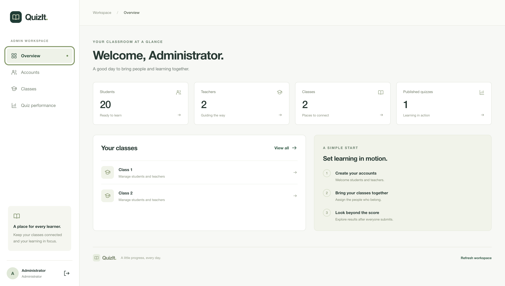

_Figure 1. QuizIt login screen._

## 3. Demo accounts and first sign-in

These demo accounts are available for testing:

| Role    | Username                | Initial demo password | Seeded class |
| ------- | ----------------------- | --------------------- | ------------ |
| Admin   | `admin`                 | `QuizDemo2026!`       | All classes  |
| Teacher | `teacher1`              | `QuizDemo2026!`       | Class 1      |
| Teacher | `teacher2`              | `QuizDemo2026!`       | Class 2      |
| Student | `student01`–`student10` | `QuizDemo2026!`       | Class 1      |
| Student | `student11`–`student20` | `QuizDemo2026!`       | Class 2      |

Enter the username and password, then select **Sign in** to open that role's workspace.
Use `admin`, `teacher1`, and `student01` for the end-to-end scenario. Select **Sign out**
before changing roles in the same browser.

Use `Smoke Test Class`, Teacher 1 (`teacher1`), Student 01 (`student01`), and a
three-question quiz named `Admin Summary Smoke Test` as the example throughout this
guide. Add your initials or a timestamp to class and quiz names if needed to avoid
confusing them with existing records, and use those names consistently.

Demo accounts are seeded only when the database has no users. They are not recreated
on every restart or deployment; existing passwords and memberships are retained.
Contact the team/admin if initial credentials no longer work. There is no self-service
registration or password reset. If QuizIt rejects your username and password, check
them and submit again. If the request times out or QuizIt cannot confirm the result,
select **Check session** and follow the message before entering credentials again. A
confirmed signed-out result restores the sign-in form; a failed check leaves **Check
session** available. Follow any displayed retry time before trying again.

## 4. Quick navigation and shared controls

Use the workspace navigation to move between your role's screens:

| Role    | Main screens                                                                  |
| ------- | ----------------------------------------------------------------------------- |
| Admin   | **Overview**, **Accounts**, **Classes**, **Quiz performance**                 |
| Teacher | **My classes**, **My quizzes**, **Create quiz**                               |
| Student | **My quizzes**, with **Start**, **Resume**, or **View results** for each quiz |

**Refresh workspace** reloads Admin accounts, classes, and quizzes. Selected class
members and quiz performance have their own refresh controls. Teachers use **Refresh
quiz** for a selected quiz; students use **Refresh quizzes** for their list. Search
and filters help locate records: Admin Accounts supports search/role filters, and
Teacher **My quizzes** supports search, class, and status filters.

In Student **My quizzes**, use **To do**, **Submitted**, and **All** to switch
between assigned quiz states; the tabs also support Left/Right, Home, and End
keyboard navigation. Search by quiz title or class and choose a class
to narrow the list; the tab counts reflect the search and class selection.
Submitted cards show the score recorded for that quiz. Your tab, search, and
class selections stay available while you move between the list, an attempt,
and results during the signed-in session.

Refresh or reopen a page to check your progress. AI generation may continue after
you leave the page. If it fails, use the offered retry control; it does not retry
automatically. If you are unsure whether a request went through, use **Repeat previous
request** when offered. If asked to wait before trying again, follow the displayed
retry time. Signing out keeps your saved answers. If a page cannot connect, reopen
the public application URL and try refresh or reconnect. If the problem continues,
report the page, action, and displayed error to the team without sharing passwords.

### Quiz and attempt states at a glance

| State or term | Meaning | What happens next |
| --- | --- | --- |
| **Draft** | A teacher is preparing a quiz. Students cannot see it. | The owning teacher generates and reviews questions, then publishes. |
| **Published** | Quiz content and the student roster are frozen for this quiz. | Students in that roster can start their attempts. Later class changes do not alter this quiz. |
| **Not started** | A student is on the published roster but has not begun an attempt. | Select **Start**. |
| **In progress** | The student's attempt has started; saved answers can be resumed. | Select **Resume**, finish answering, and submit. |
| **Submitted** | The attempt is final and graded. | Select **View results** to review the score, correct answers, and explanations. |
| **Frozen roster** | The students captured when the teacher publishes the quiz. | Every student on this roster must submit before the admin can generate a class summary. |
| **Class summary** | Exact performance metrics plus advisory AI observations for one published quiz. | Review the AI text critically; the backend metrics are authoritative. |

## 5. Complete testing walkthrough

If you are testing QuizIt for the first time, follow this example from start to finish. Each role's steps are in order, so you can complete the main journey without jumping between sections. The role guides below provide extra details and optional workflows.

Use the demo accounts listed above, selecting **Sign out** before each role change. Add your
initials or a timestamp to the example class and quiz names if needed, then use those
same names throughout. Use a new one-student class: each seeded class has ten students.

1. **Admin:** sign in as `admin`. In **Classes**, use **Create class** to create
   `Smoke Test Class`. Under **Assign an account**, assign only Teacher 1 (`teacher1`)
   and Student 01 (`student01`) using **Assign**. Check **1 teacher** and **1 student**.
2. **Teacher:** sign out and sign in as `teacher1`. Open **Create quiz**, select
   `Smoke Test Class`, and **Upload notes** using
   [Photosynthesis_O_Level.docx](../test-docs/Photosynthesis_O_Level.docx).
   Enter `Admin Summary Smoke Test`, select **3** questions, and **Create draft**.
   Select **Generate questions**, review all questions, answers, and explanations,
   check the review confirmation, and **Publish quiz**. Check **Published to 1 student**.
3. **Student:** sign out and sign in as `student01`. In **My quizzes**, find
   `Admin Summary Smoke Test` and select **Start**. Open **Need a hint?** and select **Ask for a hint** for a
   conceptual hint, using **Try again** if needed. Answer all three questions, wait
   for **Saved**, select **Submit quiz**, then **Confirm submission**. Check the **Submitted** results page.
4. **Admin:** sign out and sign in as `admin`. Open **Quiz performance**, select
   `Admin Summary Smoke Test`, and use **Refresh quiz performance**. Check
   **1 / 1 submitted** and **Ready for insights**, then select **Generate summary**.

**Expected:** the summary displays Average score, Average percentage, Score range,
and Submitted roster (**1 / 1**), alongside AI Overview, Strengths, and Areas to
review. Expand **Question breakdown** to inspect the three questions. Scores,
generated questions, and AI observations may vary.

Every student in the frozen publication roster must submit before Admin summary
generation is available. Later membership changes do not change that requirement.

## 6. Admin guide

### Overview

The **Overview** page gives a quick count of students, teachers, classes, and
published quizzes. Select a count card to open the related Accounts, Classes, or
Quiz performance page. The page also links to the first four classes and gives
shortcuts for creating accounts, assigning class members, and reviewing quiz
performance. Use **Refresh workspace** in the footer to reload these totals and
the admin workspace data.

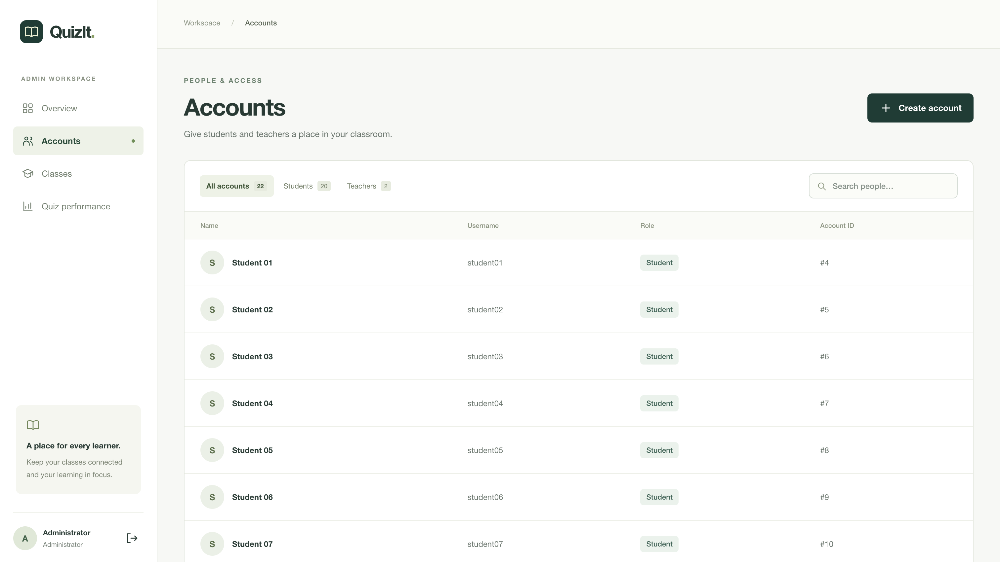

_Figure 2. Admin overview and workspace totals._

### Accounts

Open **Accounts** to find existing users or create a student or teacher account.
Creating accounts is optional for peer testing because demo accounts are already available.
Use the role tabs to show all accounts, students, or teachers, or search by a
person's display name or username. The table shows each person's name, username,
role, and account ID.

1. Select **Create account** and enter a display name (at most 100 characters).
2. Enter a username of 3–50 letters, numbers, periods, underscores, or hyphens.
3. Choose Student or Teacher, enter an initial password of 12–128 characters, and
   submit the form. Share the password securely with the account holder.

**Expected:** the message **Account created for [display name].** appears, using
the name you entered. Find the entered username in Accounts and check its role.
Additional Admin accounts cannot be created through this form.

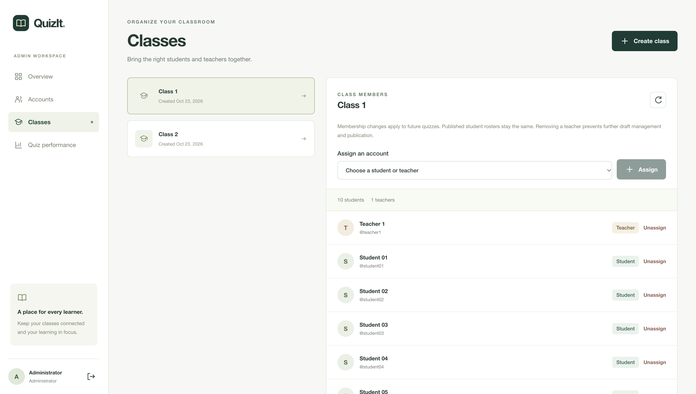

_Figure 3. Admin account list with role tabs and search._

### Classes and membership

1. Open **Classes**, select **Create class**, enter `Smoke Test Class` (or your unique
   version), and submit
   **Create class**.
2. In the class membership panel, choose a teacher or student under **Assign an
   account** and select **Assign**. Repeat for each member.
3. To remove a member, select **Unassign** beside that account.

**Expected:** **Smoke Test Class** appears in Classes. For the testing example,
its membership panel lists only Teacher 1 (`teacher1`) and Student 01 (`student01`),
with **1 teacher** and **1 student**. Check these counts before publication.

Membership changes affect future publications. They do not change existing published
student attempts or the number of students who must submit before a summary is available. Removing a teacher prevents
further access to their quizzes until assignment is restored.

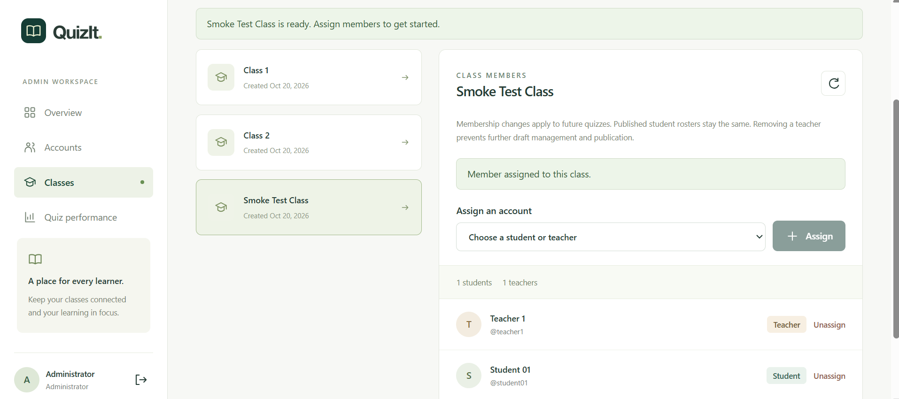

_Figure 4. Admin class membership for the one-student example class._

### Quiz performance and AI summary

Return here after students have submitted a published quiz.

1. Open **Quiz performance**, filter by class if needed, and select a published quiz.
2. Inspect submitted, in-progress, and not-started counts. Use **Refresh quiz
   performance** to update them after students submit.
3. Once every student in the frozen publication roster has submitted, select
   **Generate summary**. Expand **Question breakdown** to inspect question and option counts.

**Expected:** after `student01` submits the one-student quiz, Quiz performance shows
**1 / 1 submitted**, **Ready for insights**, and an available **Generate summary**
button. Before full completion, it shows **Awaiting submissions** and summary
generation is unavailable. After successful generation, Average score, Average
percentage, Score range, and Submitted roster appear separately from AI Overview,
Strengths, and Areas to review. Submitted roster shows **1 / 1**; expand
**Question breakdown** to find the three questions. Scores and AI wording may vary.

Review AI observations critically. The product defines no pass mark or pass rate.
Use **Retry summary** after failure or **Regenerate summary** after success. While
a replacement summary is generating, or if it fails, the previous summary is not displayed.

Before every student submits, the panel shows **Awaiting submissions** and the
number still required. The example below has a ten-student roster.

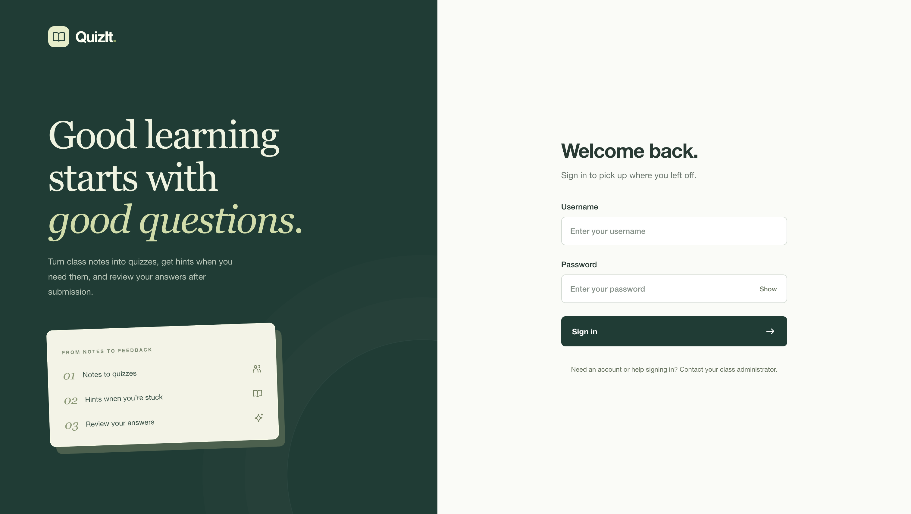

_Figure 5. Quiz performance before the full publication roster has submitted._

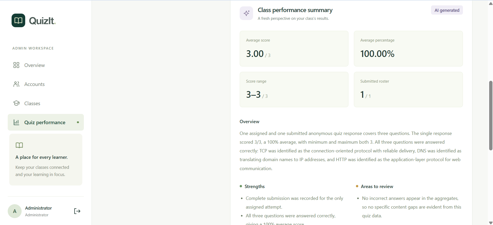

_Figure 6. Completed quiz performance with exact metrics and AI observations._

## 7. Teacher guide

Open **My classes** to see assigned classes and their draft and published quiz
counts. Select **View quizzes** to return to those quizzes, or **Create quiz** to
start a new draft.

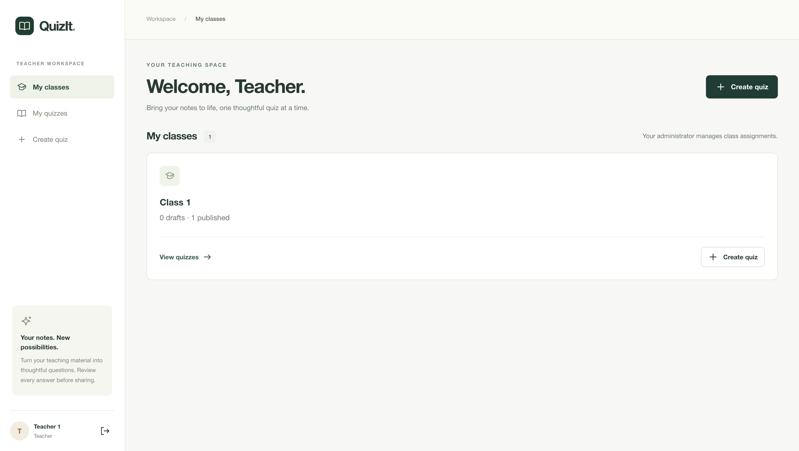

_Figure 7. Teacher class list with quiz counts and creation shortcut._

### Upload DOCX and create a draft

Open **My classes** to see your assignments. Prepare a nonempty DOCX of teaching
notes: paragraphs and table text are supported; images, equations, and external
content are not extracted. Uploads must be no larger than 5 MiB, expand to no more
than 20 MiB, and contain at most 12,000 extracted text characters.

You can download [Photosynthesis_O_Level.docx](../test-docs/Photosynthesis_O_Level.docx)
from the repository (use the file's download/raw control on GitHub), or save your own
notes as DOCX. The production smoke test used a separate `smoke-test-notes.docx`;
that file is not required. PDF and image-only notes are unsupported. If an upload
is rejected, correct the document to meet these limits and upload it again.

1. Select **Create quiz**, choose `Smoke Test Class`, select your DOCX, and select
   **Upload notes**.
2. After extraction succeeds, enter `Admin Summary Smoke Test` and choose **3**
   questions, then select **Create draft**. Titles allow at most 150 characters;
   quizzes support 1 to 10 questions (default 5).

**Expected:** the upload shows your filename followed by **is ready** and an
extracted-character count. After **Create draft**, the review page displays
**Admin Summary Smoke Test** and a question count of 3, with no generated questions
yet. Creating the draft does not call AI.

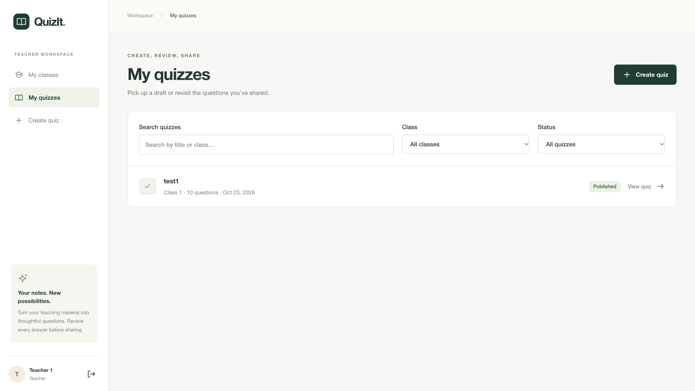

_Figure 8. Teacher create-quiz form after the notes upload._

### Generate, review, and regenerate

The new draft initially has no questions. Enter optional generation instructions
in the right panel and select **Generate questions**; review every returned
question before publishing.

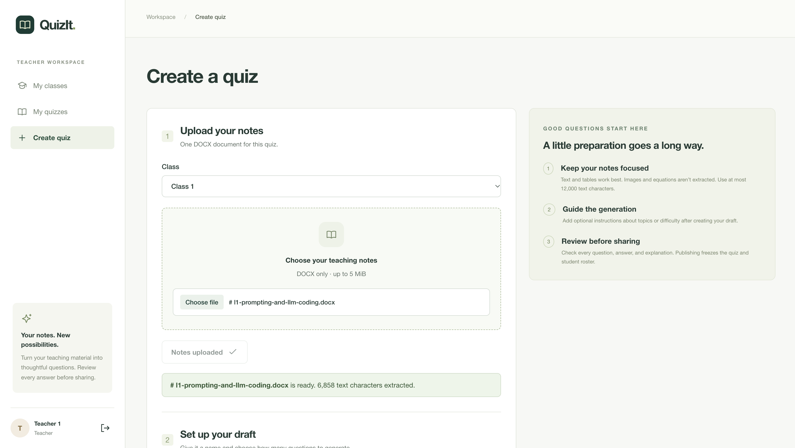

_Figure 9. Empty draft with the generation instructions and action._

1. Enter optional generation instructions of at most 1,000 characters and select
   **Generate questions**.
2. Review every generated question, all four options, its marked correct answer,
   and explanation against the notes.
3. If changes are needed, enter new instructions and select **Regenerate questions**,
   then review the new content again.

**Expected:** three numbered questions appear, each with options A to D, a marked
correct answer, and an explanation. Check all three before reviewing. After
regeneration, three questions remain; review their current content again and check
the publication review checkbox again. Generated wording may repeat or change.
Last valid questions remain visible during generation and after failure; generation
and publication are disabled while work is running. You may leave and reopen the draft.
Use **Retry generation** explicitly after failure. There is no manual question editor.

### Publish

Check the confirmation that you reviewed every question, correct answer, and
explanation, then select **Publish quiz**. A new generation request or revision clears
that confirmation, so review the current content again before publishing. Only the
owning teacher, while still assigned to the class, can publish; at least one student
must be assigned and generation must have finished. If publication is unavailable,
check these requirements and use **Refresh quiz**; review again if the questions changed.

**Expected:** for the one-student class, the page shows **Published to 1 student**
and states that the questions and student roster are frozen. Published quizzes are
read-only; AI cannot publish by itself. If a different roster was published, create
a new quiz in the intended class; the existing publication cannot be changed.

Open **My quizzes** to find a draft or published quiz. The list shows its class,
question count, publication date, and a link to the quiz.

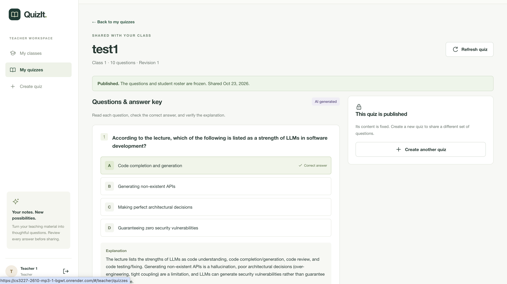

_Figure 10. Teacher quiz list with a published quiz._

Open a published quiz to review its frozen question content, answer key, and
explanation.

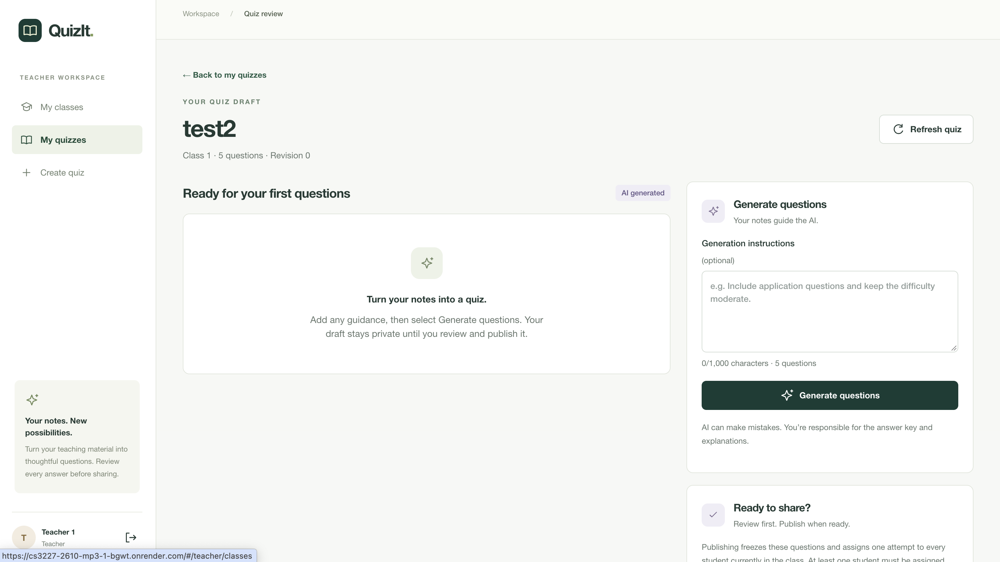

_Figure 11. Published quiz review with a correct answer and explanation._

### Delete a draft

On an unused draft, select **Delete draft**, then **Confirm deletion**. Do not delete
another tester's work. Published quizzes and drafts with running generation cannot
be deleted.

**Expected:** the quiz list opens and the deleted draft's title is no longer listed.
The draft and questions are permanently removed; uploaded notes are also removed
when no other quiz uses them. Use a separate unused draft to test deletion, so the
main testing example remains available.

## 8. Student guide

### Start or resume a quiz

Open **My quizzes**, find **Admin Summary Smoke Test** in **Smoke Test Class**,
and select **Start** for a new
attempt or **Resume** to continue. Use **Refresh quizzes** if a newly published quiz
is missing. Check your signed-in account and ask the teacher to confirm publication.
You must have been assigned when the quiz was published; being assigned afterward
does not add you to that quiz. Published assignments remain available even after
you leave the class.

**Expected:** the quiz opens with three questions and four options per question.
On **Resume**, previously saved options remain selected. Correct answers and
explanations remain hidden until your own submission.

The quiz stays on one scrolling page. Use the numbered navigator on the right
(or the horizontal strip on narrow screens) to jump to a question. It shows the
current question, save state and review flags. **Next unanswered** wraps to the next
question without a selection; a selected choice still counts as answered while
saving or after a failed save. **Mark for review** flags a question independently of
its answer, and **Review marked** visits flagged questions. Marks last only until
you leave or reload the attempt page and never block submission.

### AI hints

Open **Need a hint?** on a question, enter an optional prompt of at most 500 characters,
and select **Ask for a hint**. For example: “Give me a conceptual hint without revealing the correct option.”
The application checks the hint before showing it; rejected or unverifiable content
is withheld. Hint controls are disabled while the application checks or generates a hint.

**Expected:** a successful request displays hint text beneath the question and updates the
disclosure label to **Your hint**. If the request fails, a concise message explains why
(such as when a hint could reveal the answer or was not relevant enough) and **Try again**
is available with an editable prompt; rejected content and raw error codes are not displayed.
**Ask for a hint** reopens the current hint when one exists; **Another hint** requests
a new one. The previous hint is not displayed while a replacement is being generated
or if that request fails. If you reach the hint limit, follow the message shown.

In the verified production test, one hint was withheld with `AI_INVALID_OUTPUT`;
an explicit retry succeeded with conceptual guidance that did not explicitly name
the correct protocol or option. The exact rejection cause was not established.
Review hints critically; hint failures do not prevent answering or submitting.

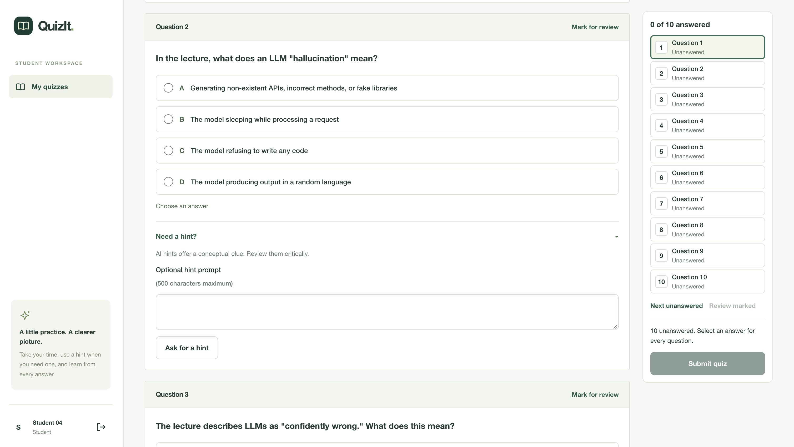

_Figure 12. Student quiz question and hint request controls before a hint is generated._

### Save answers

Select one option per question and wait for **Saved**. Each choice saves immediately;
that question is disabled while saving. You may change choices before submission.
If **Save failed** appears, select **Retry save** or explicitly change the choice.

**Expected:** **Saved** appears for each answered question. Refresh or reopen the
attempt and check that the same options remain selected. A failed save keeps the
choice visible but does not mean it was saved; resolve failed saves before submitting.

### Submit and review results

After every question is answered and saved, select **Submit quiz** from the bottom
panel or desktop navigator. Both controls remain unavailable while a choice is
missing, saving or failed. Check the readiness message and resolve any failed saves.
The confirmation reminds you that submission is final and lists any review marks.
Select **Keep reviewing** (or press Escape) to return without submitting, or
**Confirm submission** to finish.

If the response is uncertain, editing pauses while the application checks whether
submission succeeded; use **Check submission** if that check fails. Editing and new
hints remain locked until the application confirms the attempt's state.

**Expected:** the results page shows **Submitted**, the question count and a compact
**Score for this quiz** line (out of 3 for the testing example) with the submitted
date. **Submission details** lists the fraction, percentage, correct/incorrect counts,
date and finality reminder on the right, or above the review on a narrow screen.

**All questions** starts selected. Choose **Mistakes** to review only incorrect
answers, keeping their original question numbers. **Review mistakes** jumps to that
view; a perfect score offers **Review explanations** and still lets you open the
empty **Mistakes (0)** view and return with **Show all questions**. Each read-only
question shows its point value, correctness, **Your answer** and **Correct answer**
labels. A picked correct answer has both labels. Select a question's **Explanation**
row (or focus it and press Enter/Space) to open its saved explanation. Explanations
start closed and remember their state across filters during this visit. Opening
them does not generate AI content. **Refresh results** or **Try again** recovers
failed reads without discarding already loaded results.

Answers can no longer be changed; the score depends on your choices. Each correct
answer earns one point; grading does not use AI. Submitted attempts cannot be edited
or retaken. Return through **View results** to read them again.

## 9. AI security and product rules

- **Teacher approval:** AI produces draft questions. The owning teacher must review
  the current questions, answer keys, and explanations and explicitly publish them.
  Teachers remain responsible for correctness.
- **Hint protection:** hints are checked before display; invalid content can be withheld.
  AI can still misjudge relevance or answer implications, so treat hints critically.
- **Frozen publication:** publication fixes quiz content and a nonempty student roster.
  Later membership changes do not alter existing attempts or the number of students
  who must submit before a summary is available.
- **Immutable submission:** each roster student has one resumable attempt and must
  answer every question. Submission locks the attempt; only then does that student
  receive correct answers and explanations.
- **Summary eligibility:** every student in the frozen roster must submit. Metrics are
  computed by the backend; AI observations are advisory. One submission is a small
  evidence base, and no pass mark or pass rate is defined.
- **Role access:** each account has one role. Admins manage accounts/membership;
  teachers manage their own quizzes while assigned, and students access their assignments.
- **AI failures:** retries are explicit. Ordinary answer saving, submission, and
  publication of an already reviewed draft remain available during AI outages.

For local setup and technical information, see the [Developer Guide](DeveloperGuide.md).

## 10. Troubleshooting

| Problem | What to do |
| --- | --- |
| The application does not load or shows a connection error | Reopen the public application URL and refresh the page. The hosted frontend and API can be temporarily unavailable; if the problem continues, report the page and displayed message to the team. |
| Username or password is rejected | Check the spelling and sign-in details in section 3. Demo accounts are seeded only when the database is empty, so a previous deployment may have changed passwords or data. Ask the team/admin to confirm the current demo data. There is no self-service reset. |
| Sign-in times out or the result is unclear | Select **Check session** before entering credentials again. If the check confirms you are signed out, the sign-in form returns. If it cannot confirm the session, try the check again and follow any retry time shown. |
| A page or list looks out of date | Use that page's refresh control. Admin **Refresh workspace** reloads accounts, classes, and quizzes; class members and quiz performance have separate refresh controls. |
| A DOCX upload is rejected | Use a nonempty `.docx` file no larger than 5 MiB, expanding to no more than 20 MiB, with at most 12,000 extracted text characters. Images and equations are not extracted. PDF files and image-only notes are unsupported. |
| AI generation or a hint fails | Read the message beside the action and use its explicit retry control if offered. Retries are not automatic. If asked to wait, follow the displayed time. A failed or unverifiable hint is withheld; answering and submitting do not require AI. |
| A teacher cannot publish a draft | Confirm you are the owning teacher, still assigned to the class, have reviewed the current generated questions, checked the review confirmation, and that at least one student is assigned. Refresh the quiz and review again if its content changed. |
| Summary generation is unavailable | Every student in the roster frozen at publication must submit first. Refresh **Quiz performance** and confirm the submitted count equals the roster count. Membership changes after publication do not change this count. |
| A student cannot find a published quiz | Check the signed-in student and confirm they were in the class when the quiz was published. Select **Refresh quizzes**. Students added after publication are not added to that quiz's roster. |

When reporting an issue, include the role, page, action, and displayed message. Do not include passwords, session details, or private uploaded notes.
